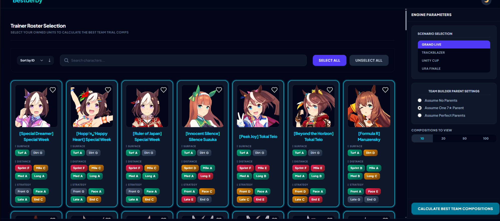
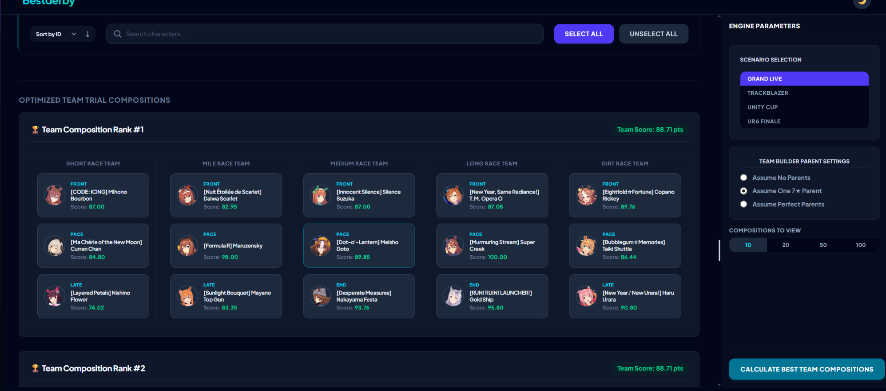

# Uma-Bestderby

**A roster-aware Team Trials optimizer for Umamusume: Pretty Derby.**

**[Try the live application](https://uma-bestderby.com/)** · **[Read the one-page project case study](Uma_Bestderby_Case_Study.pdf)**

> **3,000+ monthly page views · 740+ unique visitors**

## The problem

In Team Trials, players must assign 15 unique characters across five teams (Sprint, Mile, Medium, Long, and Dirt). Good team construction requires balancing track and running-style aptitudes, conditional skill activations, inheritance possibilities, and team composition restrictions. Comparing all of these factors manually across an entire roster is difficult.

## The solution

Uma-Bestderby recommends ranked team compositions based on a player's available characters and chosen assumptions. Players:

1. Select the characters they own.
2. Choose a training scenario and aptitude-inheritance setting (No Parents, One 7★ Parent, or Perfect Parents).
3. Run the optimizer to generate ranked five-team compositions with character-level scores.

*Roster selection, aptitude indicators, scenario selection, and parent settings.*

*Example of a ranked Team Trials lineup covering all five race categories.*

## How it works

- **Scoring model:** Character scores are prepared for combinations of training scenario, parent/inheritance setting, track, and running style. Aptitude-ineligible assignments receive a score of zero during data preparation, subject to allowed inheritance improvements.
- **Browser-side optimization:** The React frontend uses the prepared scoring information to build recommended lineups, without repeating characters or running styles within a team.
- **Data pipeline:** The game's local `master.db` is uploaded from a gaming PC to Backblaze B2 via a nightly `rclone` job. A separate parsing script extracts game data and updates MongoDB with character details and scoring information.
- **Domain-informed decisions:** Experienced players helped inform the scoring estimates, particularly for skills with conditional or inconsistent activations.

## Technologies

React · TypeScript · Node.js · Express · MongoDB · Tailwind CSS · Backblaze B2 · rclone

## Results

The live application has received **3,000+ monthly page views** and **740+ unique visitors**. It helps players identify highly competitive lineups without manually evaluating every roster combination.

## Source-code availability

This repository contains **project documentation and screenshots only**. The application's implementation repository is private. You can explore the deployed application at **[uma-bestderby.com](https://uma-bestderby.com/)**.
